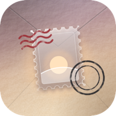

# Annales

**Your days, sealed as stamps.**

Annales is a stamp journal. Each day you cut up to three stamps from your photos, say how the day felt, and seal it. Sealing presses a real-looking postmark on every stamp, in your post office's own style, and puts the stamps into your phone's Photos. No account, no cloud, no server.

> **Pre-release (0.7.0).** Today, the Journal, Collections, Insights, ten perforations, three shapes, six looks, backups and the sibling apps on the postmark are in.

---

☕️ You can support me and Buy me a coffee ☕️

[https://buycoffee.to/szebastian](https://buycoffee.to/szebastian)

---

## What it does

- **Up to three stamps a day.** Pick a photo, choose **Portrait**, **Square** or **Wide**, move and pinch it under the frame, and it comes back with a perforated edge cut from the photo itself.
- **How did it feel?** Drag along the horizon: it frowns towards Very Unpleasant in violet and smiles towards Very Pleasant in blue, with a glowing orb riding the line. The mood dot sits in the stamp's corner.
- **One line.** Up to 200 characters about the day, with a few prompts to start from.
- **Stamp first.** The day page is the stamp on its envelope and three rows (state of mind, one line, the postmark), each opening a sheet, then Seal.
- **What shaped it.** Pick the feelings that fit the mood, and what had the biggest impact (Work, Friends, Travel…).
- **Seal the day.** In the journal, each stamp gets a Poczta Polska datownik (the office over the top, the postcode underneath, the date bridge and the hour) hanging off its right edge, and wavy cancel lines over the top-left. Every hit is pressed a little differently: angle, pressure and patchy ink.
- **Inks.** Official black, the way the post office does it, or Post red and Carmine as your own touch.
- **Saved to Photos.** Sealed stamps go into an **Annales** album as clean perforated stamps, without the postmark ink (Android 10 and later). Re-sealing updates the same photo instead of adding a copy.
- **Frame it.** Pinch or use the Size slider, see the perforation over the photo, and pick a filter: Natural, Print, Faded, Dusk or Mono.
- **The Journal.** A calendar of sealed days with trips and events marked in their ink, or Pages: one page per month. Open any day straight on its stamps, full screen, with the day's line under them and the rest on the back; **Edit** opens the day page to add stamps, change it, or re-seal it (the postmark keeps its original office, date and hour).
- **Collections.** A **trip** (dates and a place: those days are stamped by that city's post office), an **event** (a wedding, a launch), an **anniversary** (one date, every year) or a hand-picked **theme**, like Coffee.
- **Turn it over.** Open a stamp full screen and tap it to see the back: the date, when it was sealed, the day's one line and how it felt. Swipe through a collection, file a stamp into a theme, or make it the cover.
- **Insights.** Your streak, your moods over a week, a month or all time, which factors and feelings come with which moods, and gentle connections (trips, your people, weekends, busy days, the full moon), each with how sure it is.
- **Ten perforations.** Classic, Scallop, Pinhole, Comb, Pinking, Wave, Rouletted, Deckle (each one torn differently), Ticket and Sticker.
- **Six looks.** Kraft, Airmail, Gallery, Herbarium, Riviera, and Ink for evenings.
- **The day's sky.** No photo? Pick the weather and get a drawn stamp with that night's real moon phase and hills in the day's mood colour.
- **On this day.** The same date in an earlier year, on the Today page.
- **The postmark card.** Each day lists what the rest of the family saw: the weather worked out the Consensus Weather way (thirteen forecast models, averaged, with how well they agree), the moon, your top track and minutes listened from **Fidelis**, what you spent against safe-to-spend from **Kalendae**, and the day's tone from **Augur**. Profile shows which of them are installed and sharing. Insights uses them too: sunny days, days with lots of music, days within budget.
- **Backups.** Save everything (journal, collections, settings, photos and stamps) to one file, optionally locked with a password (AES-256, the same format as Kalendae), and restore it on a new phone.
- **Evening reminder.** A soft nudge at 21:30 if today is still unsealed.

## Getting started

1. Open **[Releases](../../releases)** on your phone and download **annales-debug.apk** from **Latest debug build**.
1. Open the file. If Android asks, allow your browser to **install unknown apps**.
1. Open Annales and allow **notifications** for the evening reminder.
1. In **Profile**, check your **post office** and **postcode** (Gliwice 1, 44-100 to start).

Updating: install the new APK over the old one. Your journal stays.

## Privacy

Everything stays on your phone: the journal, the cropped photos and the stamps. The internet is used for one thing only, the weather: Annales asks the free Open-Meteo forecast (the one Consensus Weather uses) for your post office's town and the day, and nothing about you goes with it. Fidelis, Kalendae and Augur share their daily summaries with Annales on the phone itself, never over the internet, and only to Annales. The only other thing that leaves the app is what you seal, into your own Photos, and backup files you save yourself.

---

_Annales is Latin for yearly records: the Roman chronicles, kept year by year. It's a sibling to Consensus Weather, Hora, Caelum, Kalendae, Augur and Fidelis._

For developers

A native Android app in Kotlin and Jetpack Compose (Material 3, coroutines), with no other libraries. GitHub Actions builds a debug APK on every push to `main` and publishes it to the **latest-debug** pre-release.

| Where | What it is |
| --- | --- |
| `data/` | `JournalStore` (journal.json, photos and stamps in app storage), `CollectionStore` (collections.json) and `Places`, `Insights` (all the maths for the Insights tab), `Settings`, `Tags`, `Moods`, `Ink`, `Siblings` (the weather and the sibling apps' summaries), `Backup` (backup files) |
| `render/StampRenderer.kt` | The three shapes, the ten perforations, the datownik, the wavy lines and the ink wear |
| `render/SkyStamp.kt` | The drawn sky stamp: weather, moon phase, mood-coloured hills |
| `render/Photos.kt` | Decoding picked photos, saving sealed stamps to Photos › Annales |
| `reminder/` | The 21:30 reminder and putting it back after a restart |
| `ui/` | Today (`DayPage`), Journal, Collections and their form, Insights, the crop screen, the viewer, Profile and the six looks |
| `tools/icon.js`, `tools/icon.html`, `tools/icon.sh` | Draw the icon and render every PNG in `icons/` and the launcher layers |
| `tools/install.sh` | Waits for the build of your last push and installs it on the plugged-in phone |
| `.github/workflows/android.yml` | Builds the APK and publishes it to the latest-debug release |
| `SHARING.md` | How Fidelis, Kalendae and Augur share a day with Annales: the address, who may ask, and every key |

**Signing.** `annales-debug.keystore` is the family's debug key, so every build installs over the last one.

**Build and install:** push to `main`, then run `tools/install.sh`. **Icon:** edit `tools/icon.js`, then run `tools/icon.sh`.

